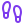
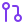

<!-- readme-standard: 2026-11-02 -->

# 📜 PIR® Literature Committee (LitCom)

*The canonical home of PIR®'s published literature, so the website, meeting hosts and A.L.E.X. all link to the same current versions.*

 **You are here:** PIR® › source `literature-committee` (private) → twin `literature-committee-public` (public, listed paths only) · `main` is the working branch

##  TL;DR

1.  **What this is.** The Steps and Traditions, meeting materials, pamphlets and books, in their current versions.
2.  **Who it is for.** Meeting hosts, members and newcomers, and anyone who wants to serve. No experience is needed.
3.  **Do this first.** [Browse the PDFs](https://psychedelicsinrecovery.github.io/literature-committee-public/). Found a typo? Open a `/litcom` ticket and quote the page and line.

> 🌐 [Literature Committee page](https://service.psychedelicsinrecovery.org/literature-committee/) · 📚 [Browse the PDFs](https://psychedelicsinrecovery.github.io/literature-committee-public/) ·
> 🎫 Requests or corrections? Type `/litcom` in [PIR®'s Discord](https://discord.gg/MyprTq8w95) or use the [web helpdesk](https://psychedelicsinrecovery.github.io/alex-desk-public/portal.html#litcom)

The **Literature Committee** of **Psychedelics In Recovery™ (PIR®)** writes, reviews and publishes the fellowship's
literature: the Steps and Traditions, meeting materials, pamphlets and books. This repository is the **canonical
home of PIR®'s published literature**, so the website, meeting hosts and A.L.E.X. (PIR®'s helper) all link to the
same current versions.

## 📚 Current literature (2026)

| 📄 Document | Use it for |
|---|---|
| [The 12 Steps](https://psychedelicsinrecovery.github.io/literature-committee-public/publications/2026/PDF%20exports/PIR_12%20Steps_2026.pdf) | Reading in meetings; step work |
| [The 12 Traditions](https://psychedelicsinrecovery.github.io/literature-committee-public/publications/2026/PDF%20exports/PIR_12%20Traditions_2026.pdf) | How groups stay unified, anonymous and self-supporting |
| [The Preamble](https://psychedelicsinrecovery.github.io/literature-committee-public/publications/2026/PDF%20exports/PIR_Preamble_2026.pdf) | Opening a meeting |
| [Guiding Principles](https://psychedelicsinrecovery.github.io/literature-committee-public/publications/2026/PDF%20exports/PIR_Guiding%20Principles_2026.pdf) | Group and online conduct |
| [Safety Guidelines](https://psychedelicsinrecovery.github.io/literature-committee-public/publications/2026/PDF%20exports/PIR_Safety%20Guidelines_2026.pdf) | Harm reduction and safety in recovery |
| [Integration and a Plan of Action](https://psychedelicsinrecovery.github.io/literature-committee-public/publications/2026/PDF%20exports/PIR_Integration%20and%20a%20Plan%20of%20Action_2026.pdf) | Integrating experiences into everyday recovery |
| [Suggested Meeting Script](https://psychedelicsinrecovery.github.io/literature-committee-public/publications/2026/PDF%20exports/PIR_Suggested%20Meeting%20Script%202026.pdf) · [All scripts](https://psychedelicsinrecovery.github.io/literature-committee-public/publications/2026/PDF%20exports/PIR%20Scripts%202026_combined.pdf) | Hosting a meeting |
| [FAQ](https://psychedelicsinrecovery.github.io/literature-committee-public/publications/2026/PDF%20exports/PIR_FAQ_2026.pdf) | Newcomers' common questions |
| [LitCom Newsletter (Jan 2026)](https://psychedelicsinrecovery.github.io/literature-committee-public/publications/2026/PDF%20exports/LitCom%20Newsletter%202026_Jan.pdf) · [LitCom blurbs](https://psychedelicsinrecovery.github.io/literature-committee-public/publications/2026/PDF%20exports/LitCom%20Blurbs.pdf) | What LitCom is working on |

📖 **Books:** *Psychedelics in Recovery: Medicines, Sacraments and Catalysts* and *The Twelve Steps for Psychedelics in
Recovery™*: see https://www.psychedelicsinrecovery.org/book/

🗂️ The editable sources (Keynote) sit next to the PDFs in [`publications/`](https://github.com/psychedelicsinrecovery/literature-committee-public/tree/main/publications/2026) on GitHub.

## 🎫 Requests, corrections and ideas
- **Found a typo or something outdated?** Open a `/litcom` ticket and quote the page and line.
- **Need a reading, a script or a translation?** Ask with `/litcom`.
- **Want something new written?** Ideas are welcome: they become a LitCom discussion.

## 🙋 Serve with LitCom
Readers, writers, editors, proofreaders and translators are welcome, and no experience is needed. LitCom meets the
2nd Tuesday of each month (details in the 🖨lit-com channel), or tap **Serve with LitCom** in that channel.

## 🗄️ The private side
This public repository is a filtered copy of LitCom's private working repo, published automatically by an allowlist
(only this README, its pictures in `assets/`, and `publications/`). Proposals, minutes and committee manuscripts stay private.

##  Suggest a change

Found a typo or something outdated? Type `/litcom` in [PIR®'s Discord](https://discord.gg/MyprTq8w95) or use the [web helpdesk](https://psychedelicsinrecovery.github.io/alex-desk-public/portal.html#litcom), and quote the page and line. LitCom reads them. Members with access may send a pull request against `main` here, and a person with the role merges; the public mirror takes none.

## 📄 License
- 📚 **Everything here is all rights reserved**, see [`LICENSE`](LICENSE). Please ask before reproducing or redistributing.
- 🏷️ **Names, logos and marks:** see [`TRADEMARKS.md`](TRADEMARKS.md)

PIR® and Psychedelics In Recovery™ are marks of Psychedelics In Recovery, a 501(c)(3) nonprofit. Please ask
LitCom before republishing PIR® literature.

The front door follows the living [README standard](https://github.com/drasticstatic/my-template/blob/main/README-STANDARD.md). Copy it, improve it.
